# Ham Shack

**A dark, radio-styled WordPress theme for amateur radio operators** – blog, events calendar, QSO logbook with QRZ.com sync, live rig frequency and FT8 decodes, QSO map, awards tracking, satellite passes, eQSL cards, a Morse trainer and more.

Install it, type in your callsign, and your station website is ready: the logo, Morse-code underline and QSL card are drawn from **your** callsign.


> **New in 2.1** – live MUF map and band openings, best-times heat map, space weather & storm alerts, automatic contest calendar with a live scoreboard, Discord/Telegram notifications, Club Log (Most Wanted + real-time upload), NEW ONE badges, QSL card wall, sked booking, repeater map, web SDR, APRS position, an installable app (PWA) with offline mode, and a light/dark switch.
>
> **New in 2.0** – QSO map, awards & statistics, live FT8 decodes from WSJT-X, DX cluster, PSK Reporter, greyline map, satellite passes, POTA/SOTA activations, photo gallery, downloadable eQSL cards, online QSL requests (OQRS), Morse trainer & quiz, e-mail newsletter, SEO, backups and a Polish translation. See the [changelog](CHANGELOG.md).

---

## Features

### Station & logbook

| | |
|---|---|
| **Your identity, automatically** | The logo and QSL card are generated from your callsign (with a Morse underline and the prefix digit highlighted). A setup wizard asks for your callsign, name, QTH, locator, ITU/CQ zones, licence and time zone. |
| **On-air status** | On air / Portable / Listening / QRT, with frequency and mode. Shown in the header, on the home page and in a widget. Switch it from the WordPress admin bar or the Dashboard. |
| **Events calendar** | Contests, nets, activations and club nights, with weekly, fortnightly or monthly repeats. Local time and UTC, DST-safe. Month view, agenda, event types with colours, an **iCal feed** and "Add to Google Calendar" links. |
| **QSO logbook** | Quick log from the Dashboard and **ADIF import/export**. Visitors get a public *"Are you in my log?"* search and statistics. Names, QTHs and notes stay private. |
| **QRZ.com Logbook sync** | Pulls new QSOs and QSL/LoTW confirmations from QRZ.com every 15 min, 30 min, hour or day. Never creates duplicates. |
| **Automatic DXCC data** | Every QSO is enriched with DXCC entity, continent, CQ/ITU zones, position and distance – from the locator, QRZ.com data or the AD1C country file (auto-updated monthly). |
| **eQSL for visitors** ✨ | Anyone who finds their callsign in the log can download a personal QSL card (PNG, 1800×1160) for each QSO. |
| **OQRS – QSL requests** ✨ | Visitors request a paper card (bureau / direct / swap). You get an e-mail and a list in the admin; *Mark card as sent* updates the log, e-mails the requester and deletes their postal address. |

<p>
  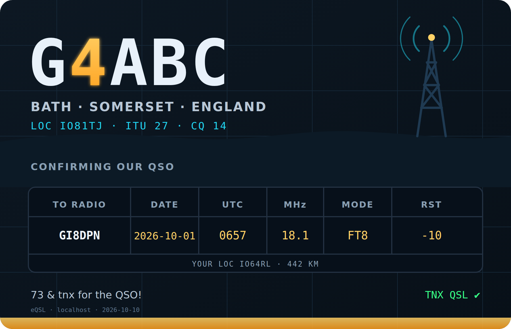
  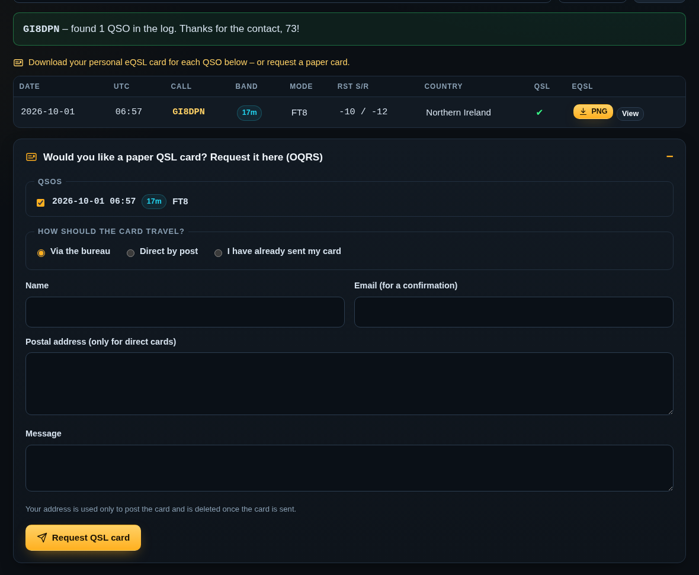
</p>

### Maps & awards ✨

| | |
|---|---|
| **QSO map** | Everyone in your log on a world map with great-circle paths, band/mode filters, a grid-square view, day/night overlay, callsign search and your longest contacts. Zoom loads a detailed coastline. |
| **Stats & awards** | Progress for DXCC, WAC, WAZ, ITU zones, WAS, the British Isles entities, grid squares and VUCC, with worked/confirmed cells, a DXCC × band table and charts (per month, band, mode, hour of day, country, year). |
| **Activations** | POTA / SOTA / WWFF / IOTA activations on a map with photos and write-ups; QSO counts come straight from `MY_*_REF` in the log. |

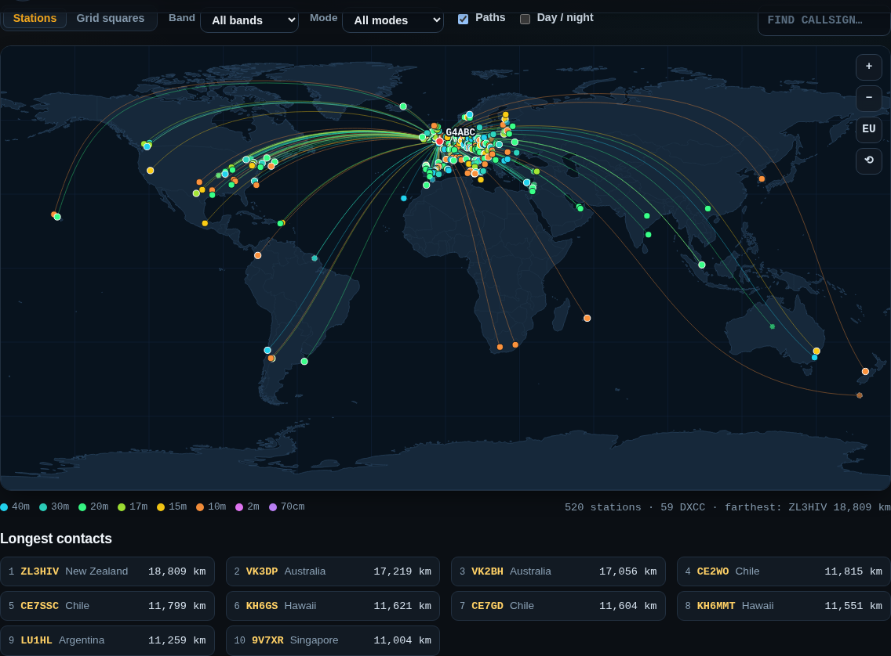
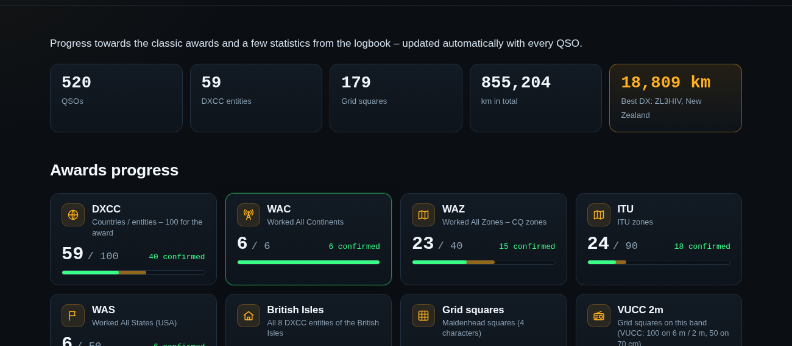

### Live from the shack ✨

| | |
|---|---|
| **Live rig (HRD)** | Frequency and mode update live from your radio through Ham Radio Deluxe, with automatic ON AIR / OFF AIR. |
| **WSJT-X decodes** | Rig Link 2.0 listens to WSJT-X: live FT8/FT4 decodes on the site with a map of who you hear, stations calling *you* highlighted, and QSOs logged in WSJT-X added to the logbook immediately. |
| **Greyline** | Day/night map with the twilight band, UTC and local clocks, sunrise and sunset at your QTH. |
| **PSK Reporter** | Map and list of stations that decoded your signal in the last 6 hours. |
| **DX cluster** | Latest spots (HamQTH, DX Summit fallback) filtered to your bands and CW/SSB/digital; spots of your own call are highlighted and remembered. |
| **Satellites** | 48-hour pass predictions for ISS, SO-50, RS-44, AO-7, FO-29, AO-73, IO-117, AO-123 and more, computed in the browser (SGP4), with live positions, footprints and a sky plot. |

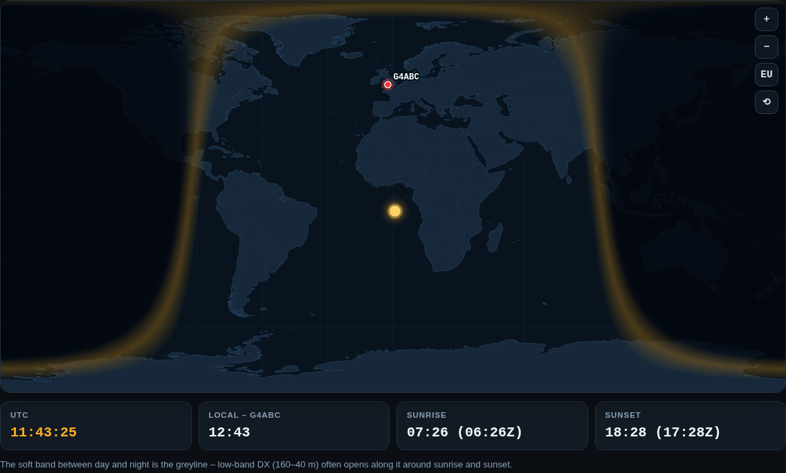
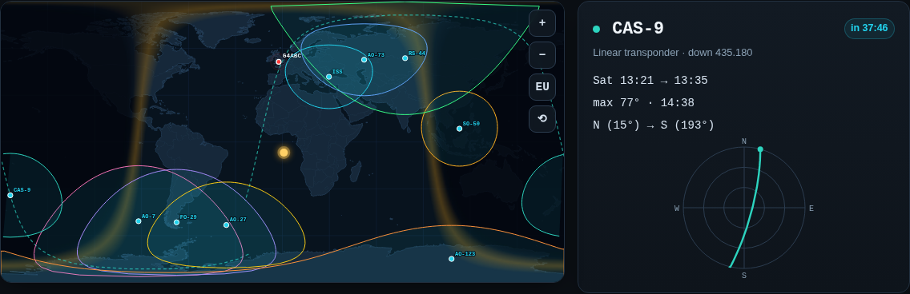

### Propagation & contests 🆕

| | |
|---|---|
| **Live MUF map** | Ionosonde data ([KC2G](https://prop.kc2g.com/) / GIRO) on the world map, refreshed every 15 minutes, plus *open / marginal / closed* chips for each HF band from the stations nearest to you. |
| **Best times from my QTH** | A heat map of continent × UTC hour built from your own log – per band – so you can see when each path usually works. |
| **Space weather** | Planetary K index from NOAA SWPC with a 3-day chart and an **aurora alert** at Kp ≥ 5. |
| **Weather at the shack** | Open-Meteo forecast with a **thunderstorm warning** (disconnect the antennas!), gust warning and a link to the live Blitzortung lightning map. |
| **Contest calendar** | The next 8 days of contests from the [WA7BNM Contest Calendar](https://www.contestcalendar.com/), imported daily, with keyword filters. They stay out of your calendar until you tick **I'm taking part**. |
| **Live contest scoreboard** | While you are in a contest: QSOs, rate per hour, last hour, DXCC, CQ zones, bands and the last 10 QSOs – on the home page, refreshed every minute. |

<p>
  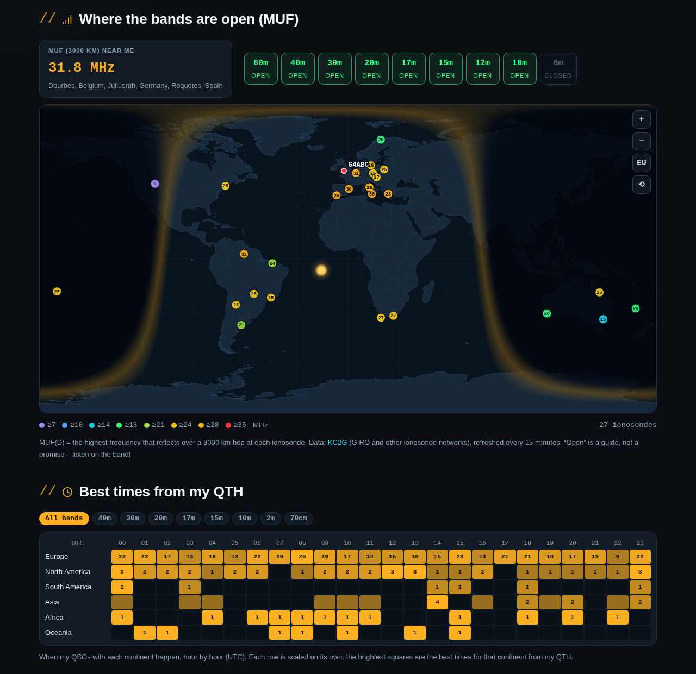
</p>
<p>
  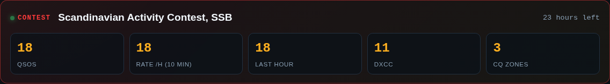
</p>

### Community & integrations 🆕

| | |
|---|---|
| **Notifications** | Automatic messages to a **Discord** channel, a **Telegram** channel or any JSON web hook (Zapier / Make / IFTTT → Facebook, X, e-mail): going on air, new post, new DXCC, spotted on the cluster, aurora, thunderstorm, new sked request. Sent in the background, rate-limited, never pings `@everyone`. |
| **Club Log** | DX-cluster spots are marked **NEW ONE**, *new band* and with their Club Log **Most Wanted** rank (no account needed). Optionally every new QSO is uploaded to Club Log in real time. |
| **NEW ONE badges** | The public log marks the first QSO with each DXCC entity and grid square. |
| **QSL card wall** | Add photos of received paper cards (front and back) to a QSO; they flip on hover on the QSL Wall page and show as thumbnails in the log. |
| **Book a sked** | A form for arranging a contact (date & time in UTC, band, mode, frequency). Accept it with one click: it goes into your calendar and the other station gets an e-mail with a Google Calendar link and an .ics file. |
| **Repeater map** | Repeaters around your station on a map and in a table – automatically from ukrepeater.net in the UK, or your own list anywhere else. |
| **Web SDR** | Embed your KiwiSDR / OpenWebRX or a public WebSDR on the Live page ("Listen here"). |
| **APRS** | Your last position from aprs.fi on the Live page while you are portable. |
| **App & speed** | Installable **PWA** (home-screen icon, offline copies of recently visited pages, shortcuts), a **light / dark** switch, WebP uploads, deferred scripts and no emoji script. |

<p>
  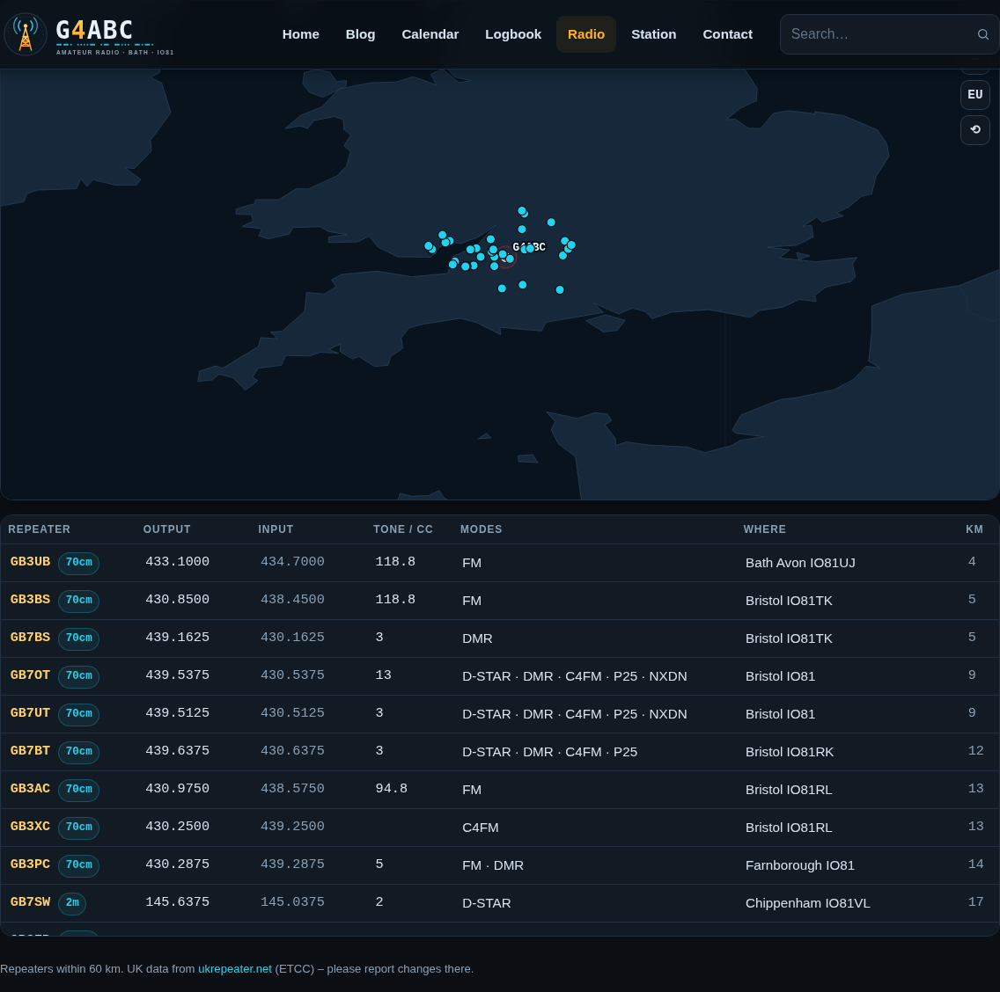
  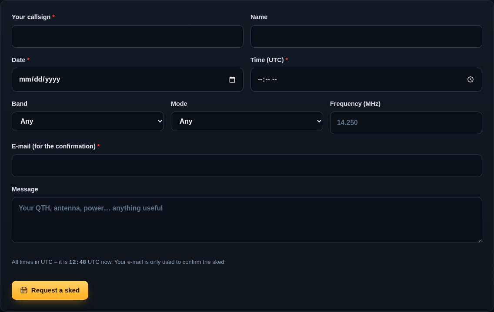
</p>
<p>
  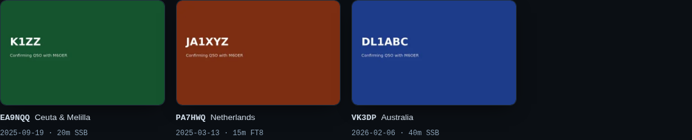
  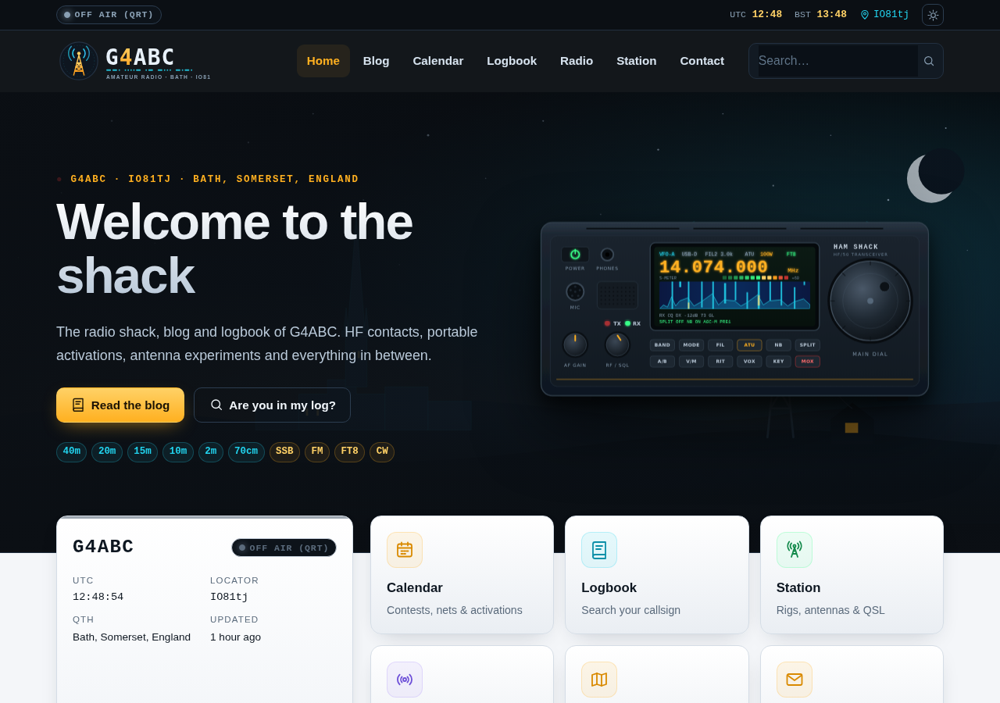
</p>

### Learning, community & housekeeping ✨

| | |
|---|---|
| **Morse trainer** | Koch method (40 lessons, Farnsworth spacing), callsign copy with adaptive speed, text-to-Morse and a clickable chart. |
| **Practice quiz** | 40 original Foundation-style questions with explanations. |
| **Gallery** | Mark photos in the Media Library (or use the bulk action), group them in albums; lightbox for galleries and images in posts. |
| **Newsletter** | Double opt-in sign-up (box under posts, widget, shortcode); new posts are e-mailed in small batches; one-click unsubscribe deletes the address. |
| **SEO** | Meta descriptions, Open Graph/Twitter cards and JSON-LD (WebSite, Person, BlogPosting, Event). Switches itself off when Yoast, Rank Math, AIOSEO or SEOPress is active. |
| **Backup & export** | One ZIP with the logbook (ADIF), settings, events, activations, QSL requests and subscribers – secrets excluded. Restore settings from JSON. |
| **Translations** | Fully translatable; **Polish** included. With [Polylang](https://wordpress.org/plugins/polylang/) you get an EN \| PL switcher and translatable station texts. |
| **QRZ.com biography** | One-click HTML for your QRZ.com page with live status and logbook images. |
| **Band conditions** | Official [N0NBH](https://www.hamqsl.com/solar.html) banners – 12 variants. |

<p>
  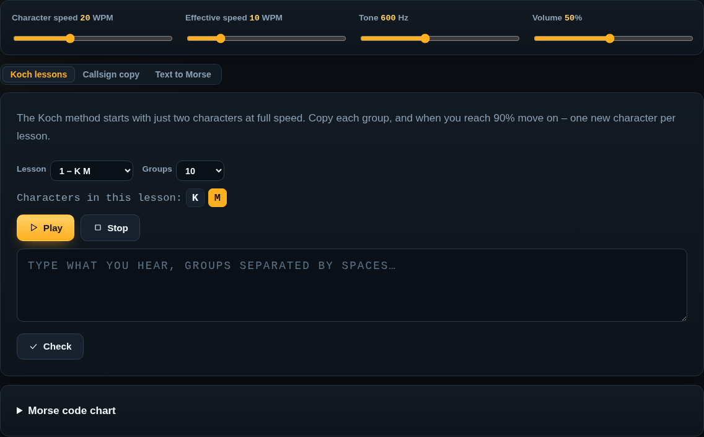
  
</p>
<p>
  
  
</p>

---

## Requirements

- WordPress **6.3+** and PHP **7.4+** (tested on WordPress 7.1); HTTPS for the installable app
- *Optional* – QRZ.com sync: a QRZ.com subscription that includes Logbook API access
- *Optional* – Live rig / FT8: Windows 10/11 with Ham Radio Deluxe and/or WSJT-X 2.x
- *Optional* – a Club Log account (app password + API key) for real-time upload, a free aprs.fi API key for APRS, a Discord web hook or Telegram bot for notifications

## Installation

1. Download `hamshack-theme.zip` from [Releases](../../releases) (or zip the `hamshack/` folder).
2. **Appearance → Themes → Add New → Upload Theme** → choose the zip → **Install** → **Activate**.
3. Click **Run site setup** in the notice (or **Ham Shack → Setup & help**), fill in your station and press the button. Pages, menus (including a **Radio** menu with Live, QSO Map, Stats & Awards, Satellites, Activations, Gallery and Learn), categories, event types and widgets are created for you.
4. **Ham Shack → Station settings**: radios, antennas, bands, modes, home-page texts, social links, contact e-mail – and your exact latitude/longitude for maps and satellite passes.

> Texts can contain `{callsign}`, `{qth}` and `{locator}`, which are filled in automatically.

### Updating from 2.0

Upload the new zip and choose **Replace current with uploaded**, then open any admin page: the theme adds **Propagation, Contests, Book a sked, Repeaters** and **QSL Wall** to the **Radio** menu and schedules the daily contest import. Set up notifications, Club Log, APRS and the web SDR in **Ham Shack → Integrations**. Rig Link is unchanged.

### Updating from 1.x

Upload the new zip and choose **Replace current with uploaded**. On the next admin page load the theme adds the new pages and the **Radio** menu, a newsletter widget, and enriches existing QSOs in the background. Update Rig Link too if you use it.

## QRZ.com logbook sync

1. On QRZ.com, open **Logbook settings** and copy the **API key**.
2. **Ham Shack → QRZ sync & ADIF**: paste the key, tick *automatic sync*, pick an interval, **Save**.
3. **Sync now** for the first full download.

WordPress runs scheduled tasks only when someone visits the site. For reliable syncing (and newsletter sending) add a real cron job in your hosting panel, every 15 minutes:

```bash
cd /home/USER/path-to-wordpress && /usr/local/bin/php -q wp-cron.php >/dev/null 2>&1
```

## Rig Link – frequency and FT8 from the shack PC

```
Radio ──CAT──▶ HRD Rig Control ──TCP 7809──┐
WSJT-X ──────────────UDP 2237 (localhost)──┴──▶ Rig Link ──HTTPS──▶ your website
```

1. **Ham Shack → Live rig**: tick **Enable**, **Save**, copy the token (shown once).
2. On the shack PC unzip [`riglink/`](riglink) to a permanent folder; put your site URL and token in `config.txt`.
3. In WSJT-X: **Settings → Reporting → UDP Server** `127.0.0.1`, port `2237`. (Using JTAlert/GridTracker too? Use the multicast address `239.255.0.1` everywhere and set `WsjtxMulticast=239.255.0.1`.)
4. Run `1-TEST.bat` (checks HRD and WSJT-X separately), then `2-ENABLE-AUTOSTART.bat`.

Rig Link is **read-only**, listens on localhost only and is a plain PowerShell script – nothing to install. Details in [`riglink/README.txt`](riglink/README.txt).

## Shortcodes

| Shortcode | Output |
|---|---|
| `[hamshack_calendar]` | Month calendar with navigation, legend, agenda and iCal link |
| `[hamshack_events limit="5"]` | List of upcoming events |
| `[hamshack_logbook per_page="25"]` | Public logbook with callsign search, statistics, eQSL and OQRS |
| `[hamshack_logbook_stats]` | QSO statistics and band bars only |
| `[hamshack_qso_map]` | World map of the logbook |
| `[hamshack_awards]` | Awards progress and charts |
| `[hamshack_live]` | Complete live page (status, FT8, greyline, PSK Reporter, DX cluster, N0NBH) |
| `[hamshack_ft8]` · `[hamshack_greyline]` · `[hamshack_psk]` · `[hamshack_dx_cluster]` | The live widgets one by one |
| `[hamshack_satellites]` | Satellite passes and live positions |
| `[hamshack_activations]` | Activations map and list |
| `[hamshack_gallery album=""]` | Photo gallery |
| `[hamshack_morse]` · `[hamshack_quiz count="10"]` | Morse trainer and practice quiz |
| `[hamshack_propagation]` | Complete propagation page (MUF, best times, space weather, weather, N0NBH) |
| `[hamshack_muf]` · `[hamshack_best_times]` · `[hamshack_space_weather]` · `[hamshack_weather]` | The propagation widgets one by one |
| `[hamshack_contests]` · `[hamshack_contest]` | Upcoming contests · live scoreboard (shows only during a contest you entered) |
| `[hamshack_sked]` | Sked booking form |
| `[hamshack_repeaters]` | Repeater map and table |
| `[hamshack_qsl_wall]` | Wall of received QSL cards |
| `[hamshack_sdr]` · `[hamshack_aprs max_age="24"]` | Web SDR player · last APRS position |
| `[hamshack_subscribe]` | Newsletter sign-up form |
| `[hamshack_contact]` | Contact form |

## Endpoints

| URL | What it returns |
|---|---|
| `/?hamshack_ics=all` | iCal feed of all events |
| `/?hamshack_badge=status` · `log` · `logo` · `qsl` | Live SVG images (for QRZ.com) |
| `/?hamshack_qsl=<id>&call=<CALL>` | A visitor's eQSL card (SVG; only for the matching callsign) |
| `/?hamshack_pwa=manifest` · `sw` · `offline` | Web app manifest, service worker and offline page |
| `GET /wp-json/hamshack/v1/rig` · `/live` · `/map` · `/dx` · `/psk` | Public JSON for the live widgets and the map (no private QSO fields) |
| `POST /wp-json/hamshack/v1/rig` · `/wsjtx` | Rig Link updates (need the `X-HamShack-Token` header) |

## Privacy & security

- Only callsign, date, time, band, mode, RST, country and position of each QSO are public.
- The QRZ API key, Rig Link token, Club Log password and API key, aprs.fi key and web-hook URLs never appear on public pages or in backups (the settings screen shows only their last 4 characters); the token is compared in constant time.
- Public forms use a signed time stamp (works with page caching), a honeypot, a minimum fill time and rate limiting; logged-in users also get a nonce.
- The service worker never stores pages viewed while logged in. QSL-request addresses are deleted once the card is sent; unsubscribing deletes the e-mail address. Subscriber and QSL-request screens are admin-only.

## Data sources & credits

- Solar-terrestrial banners by **Paul L Herrman, N0NBH** – [hamqsl.com](https://www.hamqsl.com/solar.html) (credit link always kept).
- Country file **cty.dat/cty.csv** by Jim Reisert AD1C – [country-files.com](https://www.country-files.com/).
- DX spots from [HamQTH](https://www.hamqth.com/) / [DX Summit](https://www.dxsummit.fi/); reception reports from [PSK Reporter](https://pskreporter.info/) (Philip Gladstone).
- Orbital elements from [CelesTrak](https://celestrak.org/) with [AMSAT](https://www.amsat.org/) as fallback; SGP4 by [satellite.js](https://github.com/shashwatak/satellite-js) (MIT).
- MUF data from [KC2G](https://prop.kc2g.com/) (GIRO and other ionosonde networks); Kp index from [NOAA SWPC](https://www.swpc.noaa.gov/); weather from [Open-Meteo](https://open-meteo.com/); lightning map by [Blitzortung.org](https://www.blitzortung.org/).
- Contest list from the [WA7BNM Contest Calendar](https://www.contestcalendar.com/) (Bruce Horn, WA7BNM); Most Wanted list and real-time upload by [Club Log](https://clublog.org/) (Michael Wells, G7VJR).
- UK repeater data from [ukrepeater.net](https://ukrepeater.net/) (ETCC); APRS positions from [aprs.fi](https://aprs.fi/) (Heikki Hannikainen, OH7LZB).
- Map outlines from [Natural Earth](https://www.naturalearthdata.com/) via world-atlas (public domain).
- QRZ.com, Ham Radio Deluxe, WSJT-X and other names are trademarks of their owners; this project is not affiliated with them.

## Repository layout

```
hamshack/     WordPress theme (zip this folder to install)
riglink/      Windows helper: frequency from HRD + decodes from WSJT-X
docs/         Screenshots and a Polish installation guide
```

## License

[GNU General Public License v2.0 or later](https://www.gnu.org/licenses/gpl-2.0.html), the same licence as WordPress.

**73 and see you on the bands!**
