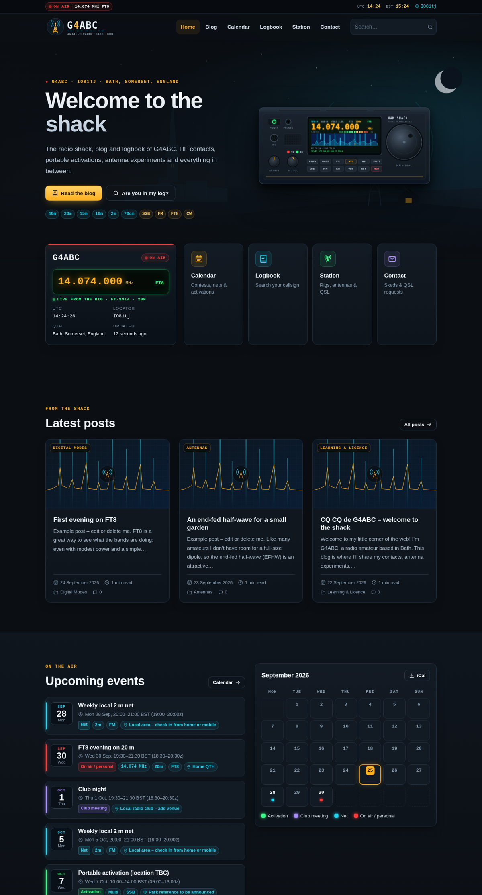
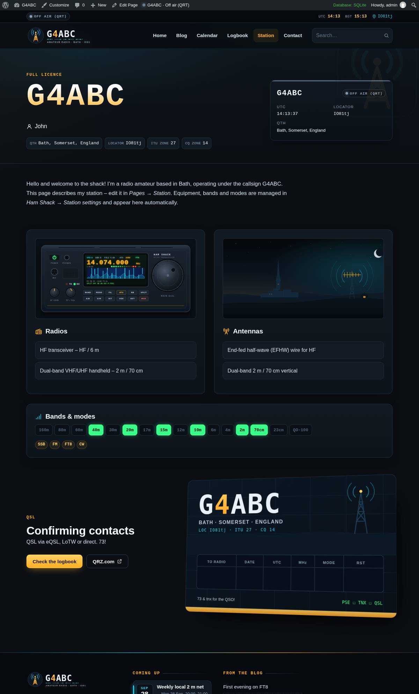
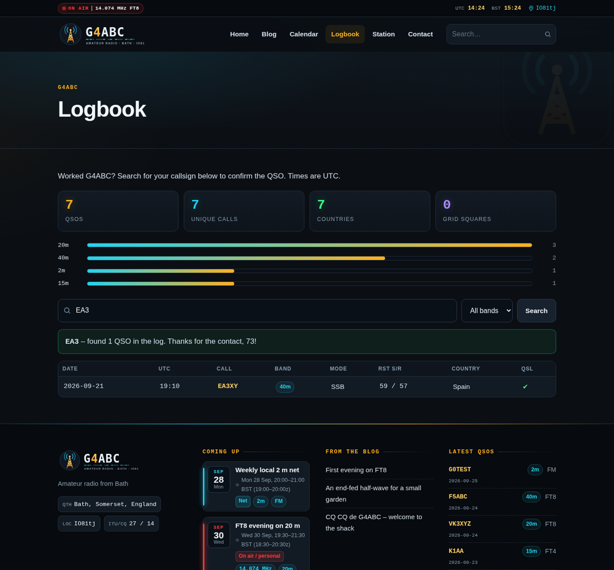
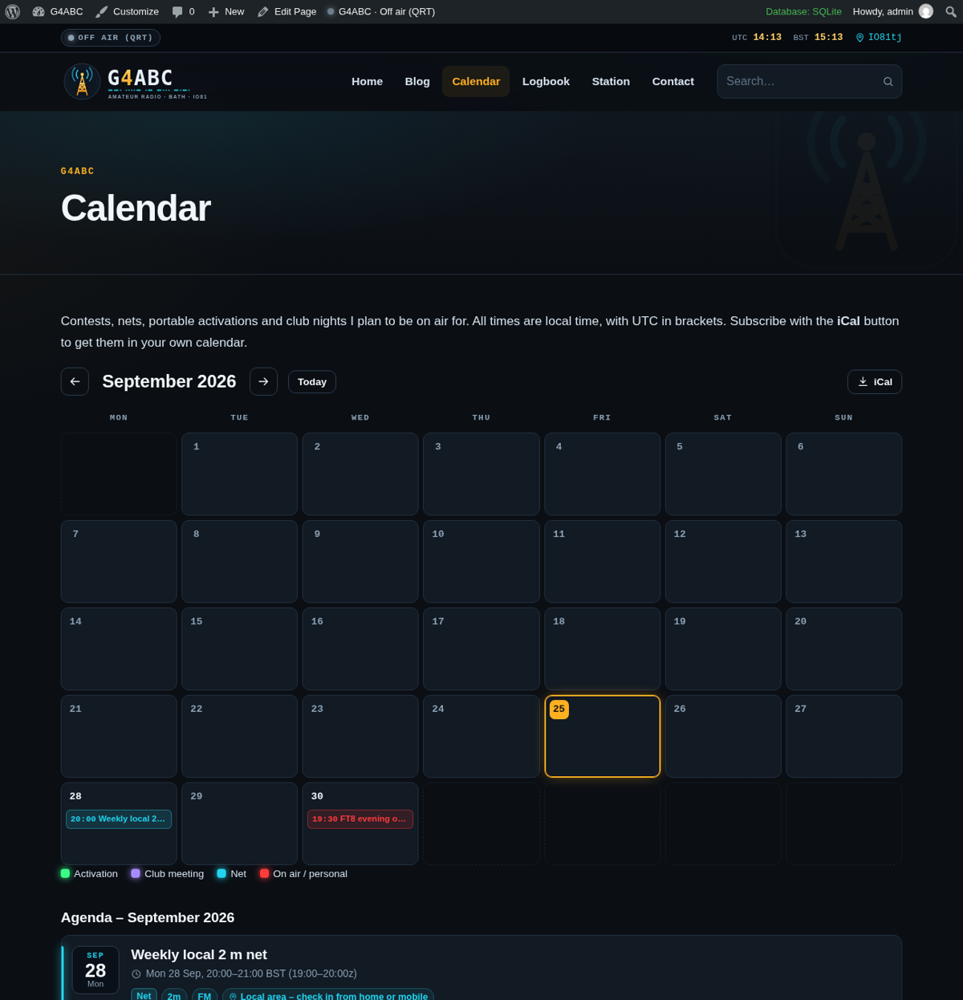
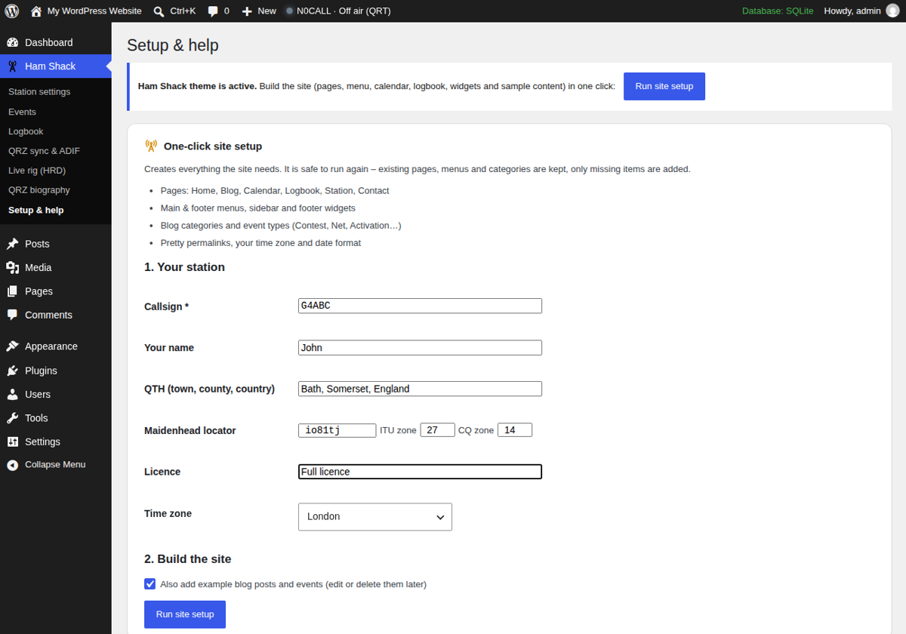
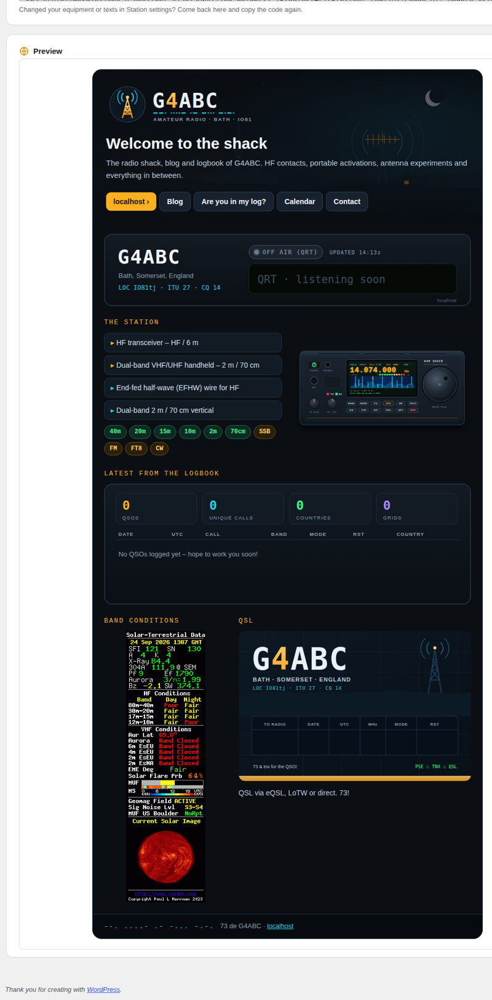

# Ham Shack

**A dark, radio-styled WordPress theme for amateur radio operators** – blog, events calendar, QSO logbook, live on-air status, QRZ.com logbook sync, live frequency straight from your rig, and a matching QRZ.com biography.

Install it, type in your callsign, and your station website is ready: the logo, Morse-code underline and QSL card are drawn from **your** callsign.



---

## Features

| | |
|---|---|
| **Your identity, automatically** | The logo and QSL card are generated from your callsign (with a Morse underline and the prefix digit highlighted). A setup wizard asks for your callsign, name, QTH, locator, ITU/CQ zones, licence and time zone. |
| **On-air status** | On air / Portable / Listening / QRT, with frequency and mode. Shown in the header, on the home page and in a widget. Switch it from the WordPress admin bar or the Dashboard. |
| **Events calendar** | Contests, nets, activations and club nights, with weekly, fortnightly or monthly repeats. Times are shown in local time and UTC, DST-safe. Includes a month view, agenda, event types with colours, an **iCal feed** for Google/Apple/Outlook and "Add to Google Calendar" links. |
| **QSO logbook** | Quick log from the Dashboard and **ADIF import/export** (WSJT-X, N1MM, Log4OM, QRZ…). Visitors get a public *"Are you in my log?"* search and statistics (QSOs, unique calls, countries, grids, bands). Names, QTHs and notes stay private. |
| **QRZ.com Logbook sync** | Pulls new QSOs and QSL/LoTW confirmations from your QRZ.com logbook every 15 min, 30 min, hour or day. Pages through large logs and never creates duplicates. |
| **Live rig (HRD)** | The frequency and mode on the site update live from your radio through Ham Radio Deluxe, with automatic ON AIR / OFF AIR. FT8/FT4/JS8 are recognised from the dial frequency. Uses the small Windows helper in [`riglink/`](riglink). |
| **QRZ.com biography generator** | One-click HTML for your QRZ.com page in the same style, with **live** status and logbook images served by your site. |
| **Band conditions** | Official [N0NBH](https://www.hamqsl.com/solar.html) solar-terrestrial banners. There are 12 variants, chosen separately for the home page and the sidebar. |
| **Station page** | Radios, antennas, a band strip, modes and the QSL card, all managed from settings. |
| **Everything else** | Contact form with anti-spam protection, widgets (status, events, latest QSOs, band conditions), responsive layout, block-editor styles and one-click creation of pages, menus and widgets. |

<p>
  
  
</p>
<p>
  
  
</p>

---

## Requirements

- WordPress **6.2+** and PHP **7.4+** (tested on WordPress 7.1)
- *Optional* – QRZ.com sync: a QRZ.com subscription that includes Logbook API access
- *Optional* – Live rig: Windows 10/11 and Ham Radio Deluxe (HRD Rig Control)

## Installation

1. Download `hamshack-theme.zip` from [Releases](../../releases). You can also zip the `hamshack/` folder yourself.
2. In WordPress, go to **Appearance → Themes → Add New → Upload Theme**, choose the zip, then **Install** and **Activate**.
3. Click **Run site setup** in the notice that appears (or go to **Ham Shack → Setup & help**). Fill in your station details and press the button.
   - The setup creates the Home, Blog, Calendar, Logbook, Station and Contact pages, the menus, blog categories, event types and widgets. It can also add example posts and events.
4. Go to **Ham Shack → Station settings** and add your radios, antennas, bands, modes, home-page texts, social links and contact e-mail.

> Texts can contain `{callsign}`, `{qth}` and `{locator}`, which are filled in automatically.

## QRZ.com logbook sync

1. On QRZ.com, open your **Logbook settings** and copy the **API key**.
2. Go to **Ham Shack → QRZ sync & ADIF**, paste the key, tick *automatic sync*, choose an interval and click **Save**. The key is tested straight away.
3. Click **Sync now** for the first full download.

WordPress runs scheduled tasks only when someone visits the site. For reliable syncing, add a real cron job in your hosting panel that runs every 15 minutes:

```bash
cd /home/USER/path-to-wordpress && /usr/local/bin/php -q wp-cron.php >/dev/null 2>&1
```

## Live frequency from your rig

```
Radio ──CAT──▶ HRD Rig Control ──TCP 7809 (local)──▶ Rig Link ──HTTPS──▶ your website
```

1. Go to **Ham Shack → Live rig (HRD)**, tick **Enable** and click **Save**. Copy the token; it is shown only once.
2. On the shack PC, unzip [`riglink/`](riglink) to a permanent folder and enter your site URL and the token in `config.txt`.
3. Run `1-TEST.bat`. It should report *"everything works!"*.
4. Run `2-ENABLE-AUTOSTART.bat`. The helper then runs hidden in the background and starts every time you log in to Windows.

Rig Link is **read-only**: it never sends anything to the radio. It is a plain PowerShell script, so there is nothing to install. See [`riglink/README.txt`](riglink/README.txt) for troubleshooting.

## QRZ.com biography

Go to **Ham Shack → QRZ biography → Copy code**. On QRZ.com, open **Edit → Biography**, switch to HTML/Source mode, paste the code and save. The status and logbook images keep themselves up to date.



> QRZ.com truncates the biography at the first emoji, so the generator strips emoji automatically.

## Shortcodes

| Shortcode | Output |
|---|---|
| `[hamshack_calendar]` | Month calendar with navigation, legend, agenda and iCal link |
| `[hamshack_events limit="5"]` | List of upcoming events |
| `[hamshack_logbook per_page="25"]` | Public logbook with callsign search and statistics |
| `[hamshack_logbook_stats]` | QSO statistics and band bars only |
| `[hamshack_contact]` | Contact form |

## Endpoints

| URL | What it returns |
|---|---|
| `/?hamshack_ics=all` | iCal feed of all events (`/?hamshack_ics=<id>` for a single event) |
| `/?hamshack_badge=status` | Live status / VFO image (SVG) |
| `/?hamshack_badge=log` | Logbook statistics + latest QSOs (SVG) |
| `/?hamshack_badge=logo` | Your callsign logo (SVG) |
| `/?hamshack_badge=qsl` | Your QSL card (SVG) |
| `POST /wp-json/hamshack/v1/rig` | Rig Link updates (needs the `X-HamShack-Token` header) |
| `GET /wp-json/hamshack/v1/rig` | Current live rig state (JSON, not cached) |

## Privacy & security

- Only the callsign, date, time, band, mode, RST and country of each QSO are shown publicly.
- The QRZ API key and the Rig Link token are stored only in your WordPress database and are never printed on public pages. The token is compared in constant time.
- All forms use nonces. The contact form has a honeypot, a minimum fill time and rate limiting.

## Tips

- **Contact form e-mails not arriving?** Install an SMTP plugin, for example WP Mail SMTP.
- **Images not showing on QRZ.com?** Allow `qrz.com` in your host's *Hotlink Protection*.
- **Using LiteSpeed Cache?** Live data is served uncached, and the cache is purged automatically when Rig Link changes the status.

## Repository layout

```
hamshack/     WordPress theme (zip this folder to install)
riglink/      Windows helper that sends the frequency from HRD to the site
docs/         Screenshots and a Polish installation guide
```

## Credits

- Solar-terrestrial data and banners by **Paul L Herrman, N0NBH** – [hamqsl.com](https://www.hamqsl.com/solar.html). The credit link is always kept, as the author requests.
- QRZ.com, Ham Radio Deluxe, WSJT-X and other names are trademarks of their respective owners. This project is not affiliated with them.

## License

Licensed under the [GNU General Public License v2.0 or later](https://www.gnu.org/licenses/gpl-2.0.html), the same licence as WordPress.

**73 and see you on the bands!**
